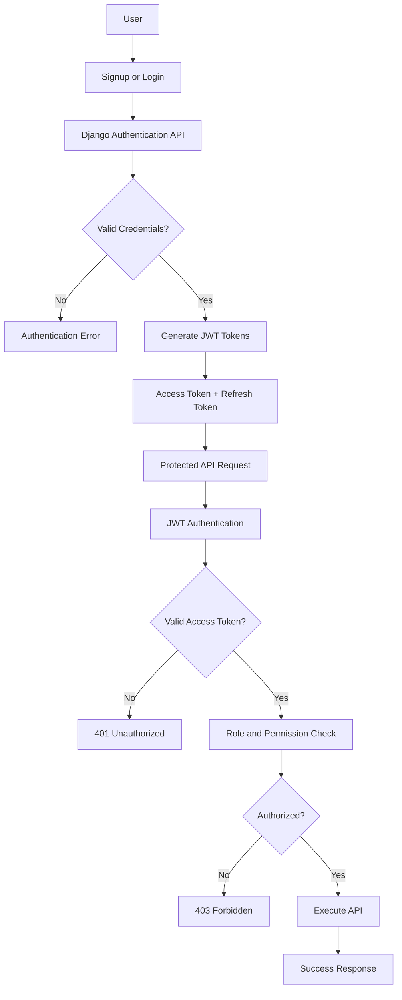

# Zecpath ATS – Authentication Flow

## 1. Overview

The Zecpath ATS backend uses Django REST Framework and SimpleJWT to provide secure, token-based authentication.

Users can register, log in using their email and password, refresh JWT tokens, and log out.

## 2. Authentication Architecture

The authentication process follows these steps:

1. User submits signup or login credentials.
2. Django validates the submitted information.
3. On successful login, JWT access and refresh tokens are generated.
4. The client stores the tokens securely.
5. The access token is included in protected API requests.
6. JWT authentication validates the access token.
7. Role-based permissions determine whether the user can access the requested resource.
8. The API returns the appropriate response.

## 3. Authentication Flow Diagram

## 4. JWT Token Details

| Token | Lifetime | Purpose |
|---|---|---|
| Access Token | 15 minutes | Access protected APIs |
| Refresh Token | 1 day | Generate new tokens |

### Refresh Token Rotation

- Refresh token rotation is enabled.
- A new refresh token is generated during refresh.
- The previous refresh token is blacklisted.
- Blacklisted refresh tokens cannot be reused.

## 5. Authentication Endpoints

| Endpoint | Method | Purpose |
|---|---|---|
| `/api/auth/signup/` | POST | Register a new user |
| `/api/auth/login/` | POST | Authenticate a user |
| `/api/auth/refresh/` | POST | Refresh JWT tokens |
| `/api/auth/logout/` | POST | Blacklist refresh token |

## 6. Authorization

The system uses role-based permissions.

- Admin – Administrative operations.
- Employer – Employer-specific operations.
- Candidate – Candidate-specific operations.

Protected API requests use the following authorization header:

`Authorization: Bearer <access_token>`

## 7. Logout Process

1. The client sends the refresh token to the logout endpoint.
2. Django validates the refresh token.
3. The token is added to the blacklist.
4. The API returns a logout success response.

## 8. Security Features

- Password hashing using Django authentication.
- Password validation.
- JWT access and refresh tokens.
- Refresh token rotation.
- Refresh token blacklisting.
- Role-based access control.
- Authenticated API access.
